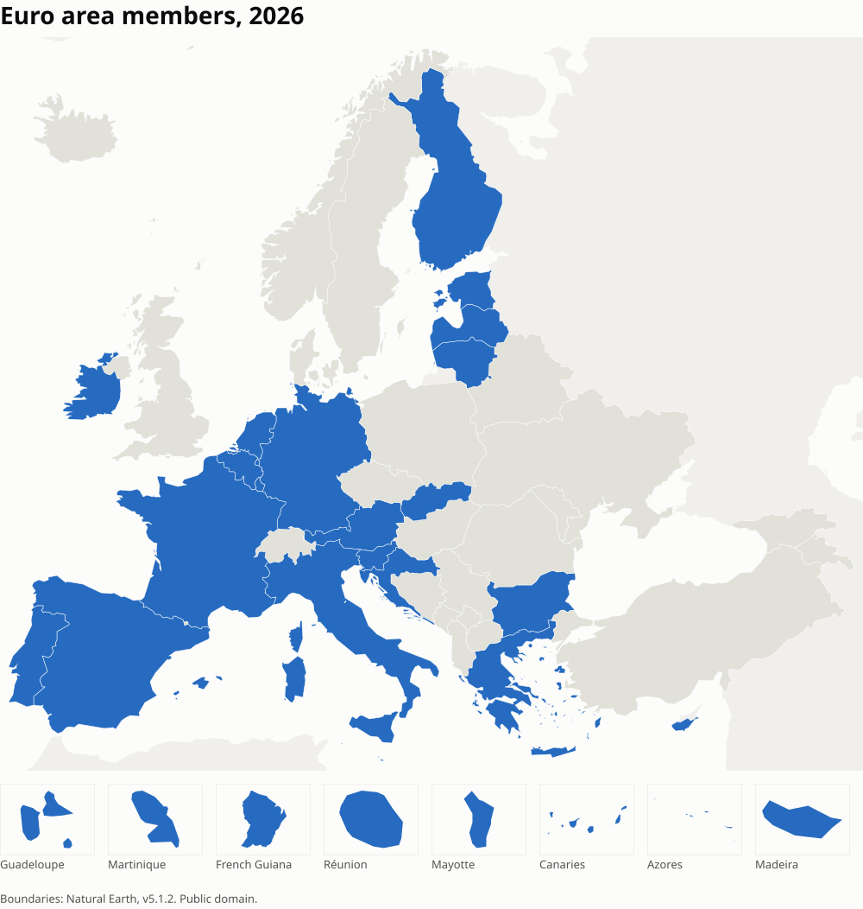
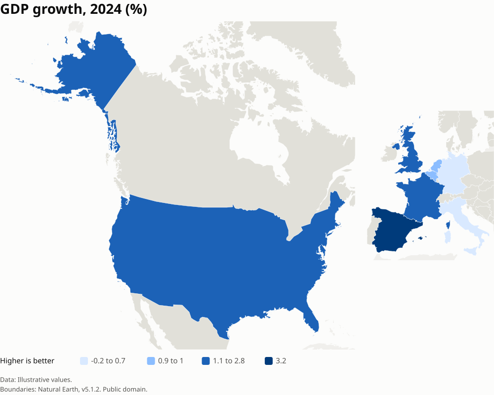
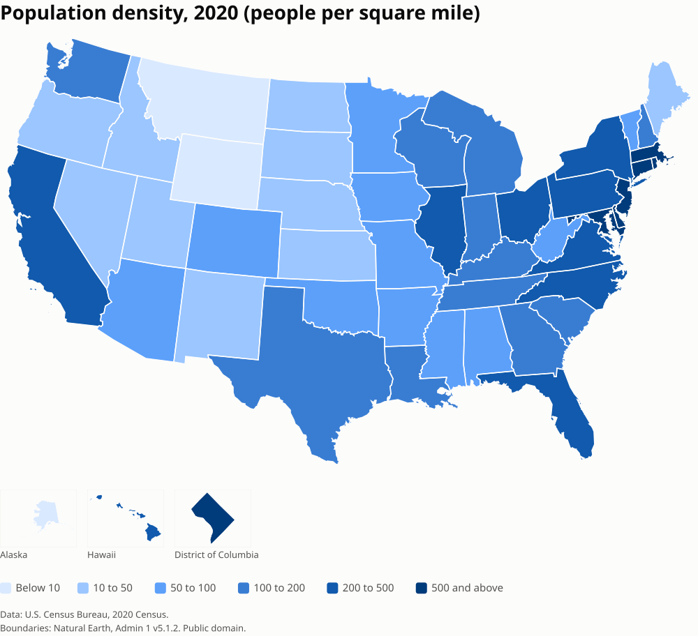
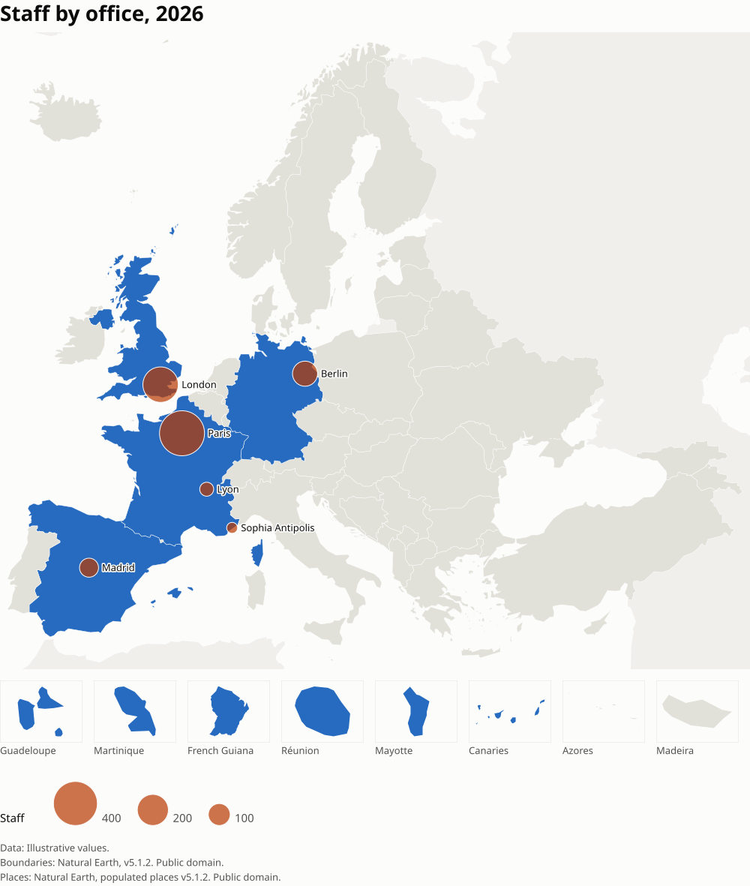

# @nicolastoulemont/minimal-map-charts

Minimal map charts for generative UI.

It is a chart, not a mapping library. There are no tiles, no pan and zoom across the globe, and no geographies beyond countries and their subdivisions. For those, use MapLibre. For other chart types, use Vega-Lite, Observable Plot or D3.

## How it works

### Generate map charts from a JSON object

Give a model the spec's JSON Schema as a tool. Whatever it sends is parsed then drawn, and either step can hand back lines for the model to fix.

```ts
import { describe, draw, parse, schema, svg } from "@nicolastoulemont/minimal-map-charts"

const tool = { name: "show_map", description: "Draw a map of countries", input_schema: schema }

const call = async (input: unknown) => {
  const parsed = parse(input)
  const drawn = parsed.ok ? await draw(parsed.spec) : parsed

  return drawn.ok ? { svg: svg(drawn.scene) } : { error: drawn.issues.map(describe).join("\n") }
}
```

For example, if the user asked which countries use the euro, the model only needs to send the following JSON payload to render the chart:

<!-- prettier-ignore -->
```json
{
  "title": "Euro area members, 2026",
  "fill": {
    "kind": "highlight",
    "countries": ["AUT", "BEL", "BGR", "HRV", "CYP", "EST", "FIN", "FRA", "DEU", "GRC", "IRL",
                  "ITA", "LVA", "LTU", "LUX", "MLT", "NLD", "PRT", "SVK", "SVN", "ESP"]
  }
}
```



A few things:

1. The container map is inferred when possible, for this chart every country is in Europe, so `draw` picks the Europe sheet.
2. Islands get insets: France's overseas regions and Portugal's and Spain's islands get insets.
3. Validation: Had the model written `"France"`, it would get back `fill.countries.0: "France" is not a country code. Did you mean "FRA"?`.
4. The page pays 28.7 kB gzipped for this: the code with `parse` and `schema`, plus the Europe sheet.

### Compare countries far apart at the same scale

For example, to compare GDP growth in the United States and Western Europe, list the countries in a layout. There is no projection to pick:

<!-- prettier-ignore -->
```json
{
  "sheet": { "places": ["USA", "GBR", "FRA", "ESP", "BEL", "NLD", "DEU", "ITA"], "insets": false },
  "title": "GDP growth, 2024 (%)",
  "source": "Illustrative values",
  "fill": {
    "kind": "choropleth",
    "values": [
      { "country": "USA", "value": 2.8 },
      { "country": "GBR", "value": 1.1 },
      { "country": "FRA", "value": 1.1 },
      { "country": "ESP", "value": 3.2 },
      { "country": "BEL", "value": 1 },
      { "country": "NLD", "value": 0.9 },
      { "country": "DEU", "value": -0.2 },
      { "country": "ITA", "value": 0.7 }
    ],
    "better": "higher"
  }
}
```



A few things:

1. Panels: countries more than 2,000 km apart are split into panels side by side.
2. Same scale: a kilometre is as long in both panels, so the countries compare by size as well as by colour. `"scale": "fit"` makes the panels equally tall instead.
3. No projection in the browser: each panel is cropped from the narrowest prebuilt sheet that holds its countries, here North America and Europe.
4. The page pays about 45 kB gzipped for this: the code, the layout code and both sheets.

### Colour a country's states or regions

Name areas by their ISO 3166-2 code with `area` instead of `country`. For example, population density by US state:

<!-- prettier-ignore -->
```json
{
  "title": "Population density, 2020 (people per square mile)",
  "source": "U.S. Census Bureau, 2020 Census",
  "fill": {
    "kind": "choropleth",
    "values": [
      { "area": "US-AL", "value": 99 }, { "area": "US-AK", "value": 1.3 }, { "area": "US-AZ", "value": 63 },
      { "area": "US-AR", "value": 58 }, { "area": "US-CA", "value": 254 }, { "area": "US-CO", "value": 56 },
      { "area": "US-CT", "value": 745 }, { "area": "US-DE", "value": 508 }, { "area": "US-DC", "value": 11280 },
      { "area": "US-FL", "value": 401 }, { "area": "US-GA", "value": 187 }, { "area": "US-HI", "value": 227 },
      { "area": "US-ID", "value": 22 }, { "area": "US-IL", "value": 231 }, { "area": "US-IN", "value": 189 },
      { "area": "US-IA", "value": 57 }, { "area": "US-KS", "value": 36 }, { "area": "US-KY", "value": 114 },
      { "area": "US-LA", "value": 108 }, { "area": "US-ME", "value": 44 }, { "area": "US-MD", "value": 636 },
      { "area": "US-MA", "value": 901 }, { "area": "US-MI", "value": 178 }, { "area": "US-MN", "value": 72 },
      { "area": "US-MS", "value": 63 }, { "area": "US-MO", "value": 90 }, { "area": "US-MT", "value": 7.4 },
      { "area": "US-NE", "value": 26 }, { "area": "US-NV", "value": 28 }, { "area": "US-NH", "value": 154 },
      { "area": "US-NJ", "value": 1263 }, { "area": "US-NM", "value": 18 }, { "area": "US-NY", "value": 429 },
      { "area": "US-NC", "value": 215 }, { "area": "US-ND", "value": 11 }, { "area": "US-OH", "value": 289 },
      { "area": "US-OK", "value": 58 }, { "area": "US-OR", "value": 44 }, { "area": "US-PA", "value": 291 },
      { "area": "US-RI", "value": 1061 }, { "area": "US-SC", "value": 170 }, { "area": "US-SD", "value": 12 },
      { "area": "US-TN", "value": 168 }, { "area": "US-TX", "value": 112 }, { "area": "US-UT", "value": 40 },
      { "area": "US-VT", "value": 70 }, { "area": "US-VA", "value": 219 }, { "area": "US-WA", "value": 116 },
      { "area": "US-WV", "value": 75 }, { "area": "US-WI", "value": 109 }, { "area": "US-WY", "value": 6 }
    ],
    "scale": { "kind": "breaks", "at": [10, 50, 100, 200, 500] }
  }
}
```



A few things:

1. The codes pick the map: `US-` codes draw the United States sheet. All areas in a fill belong to one country, and a fill names countries or areas, not both.
2. Highlights take `areas` instead of `countries`: `{ "kind": "highlight", "areas": ["FR-IDF", "FR-BRE"] }`.
3. `parse` checks each code's form and country. `draw` checks it against the sheet it loads, so a page that never names an area never downloads a list of them. Some areas keep their source's code until they are mapped to ISO 3166-2, so they cannot be named yet: `NO-30`, Viken, which Norway split into three counties in 2024, gets `fill.values.0.area: NO-30 has no area on the "NOR" sheet.` from `draw`. `scripts/build-maps/uncoded.gen.ts` lists them.
4. A subdivision given as a country gets `fill.values.0.country: expected a country code; give the subdivision "US-CA" in \`area\`.`

### Mark cities, offices or events

`points` marks sites over the map, beside any fill. Name a city with its country and the map takes its location from Natural Earth's 7,267 populated places, or give coordinates from your data:

```json
{
  "title": "Staff by office, 2026",
  "source": "Illustrative values",
  "fill": { "kind": "highlight", "countries": ["FRA", "DEU", "GBR", "ESP"] },
  "points": {
    "kind": "bubble",
    "label": "Staff",
    "sites": [
      { "place": "Paris", "country": "FRA", "value": 420 },
      { "place": "London", "country": "GBR", "value": 260 },
      { "place": "Berlin", "country": "DEU", "value": 130 },
      { "place": "Madrid", "country": "ESP", "value": 75 },
      { "place": "Lyon", "country": "FRA", "value": 40 },
      { "name": "Sophia Antipolis", "lat": 43.62, "lon": 7.05, "value": 25 }
    ]
  }
}
```



A few things:

1. Two kinds: `"dot"` shows where; `"bubble"` also shows how much, with each circle's area proportional to its value from 0. Signed values, such as changes, belong in a choropleth fill.
2. Places: a name matches without accents, case or punctuation, and by the other names Natural Earth gives, so `"Zurich"` finds Zürich and `"Washington"` finds Washington, D.C. A name several places share asks for their area: `points.sites.2.place: "Springfield" names 5 places in USA. Give \`area\`, one of US-IL, US-MA, US-MO, US-OH, US-OR.` A place Natural Earth does not list asks for coordinates.
3. Loading: each country's places are their own module, loaded the first time a site names a place there. Coordinates load nothing; a France map without a named place never fetches France's places.
4. Coordinates: `lat` and `lon` are named, so their order cannot swap them, and a latitude past 90 that would fit as a longitude gets `look swapped`. They come from the data or a geocoder: a position from memory can land a town in the wrong region of a country's map.
5. Framing: without `sheet`, the map is the narrowest region holding every country in the fill and every point, and a place counts as its country. A point off a given sheet gets `points.sites.1: "Berlin" is not on the "FRA" sheet. Sheets that hold every point: europe, extended-europe, world.`
6. Insets: a point in the Canaries, Hawaii or Réunion is drawn in that inset; Washington, D.C. shows both on the map and in its zoomed inset.
7. Drawing: larger circles first, so smaller ones sit on top. Up to 12 points are named beside their mark, where a name fits; every point has a tooltip and a row in `scene.points.sites`.

## Quick start

```ts
import { dark, draw, light, parse, svg } from "@nicolastoulemont/minimal-map-charts"

const parsed = parse({
  title: "GDP growth, 2024 (%)",
  source: "World Bank",
  fill: {
    kind: "choropleth",
    values: [
      { country: "FRA", value: 1.1 },
      { country: "DEU", value: -0.2 },
      { country: "ESP", value: 3.2 },
    ],
    better: "higher",
  },
})

const drawn = parsed.ok ? await draw(parsed.spec) : parsed

if (drawn.ok) document.body.innerHTML = svg(drawn.scene, { palette: { light, dark } })
```

A few things:

1. The map is inferred: every country in the fill is in Europe, so it draws Europe. Add the United States and it draws the world.
2. `sheet` overrides it: `"sheet": "FRA"` draws France with its regions and overseas insets. `scene.choice` is `"Given"` or `"Derived"`.
3. The map follows the page's theme with no script: `{ light, dark }` writes each colour as a CSS `light-dark()` pair, leaves out the background and takes the title's colour from the page's text. The page's `color-scheme` picks the colours, so declare it: `:root { color-scheme: light dark }` follows the reader's setting, and a theme toggle sets `color-scheme` to `light` or `dark`. A page that only swaps colours in a `prefers-color-scheme` query, without `color-scheme`, gets the light map. As a file or an ``, the map follows the reader's setting in Chrome and Firefox; WebKit draws it light. Give one palette, `{ palette: dark }`, for a map that paints its own background: images for link previews, email, or a rasterizer that does not know `light-dark()`.

## Use it with a model

The spec describes what to show, not how to draw it: countries, values and what the colours mean, never projections, joins or lightness. The shortest valid spec is a correct map, so a model has few ways to get it wrong.

A model picks colours as `"#rrggbb"`: green for forests, red for losses, blue for gains. The renderer keeps each colour's hue and chroma and sets its lightness for the page, so one spec reads on a light or a dark surface, with the lowest values nearest the surface.

1. Tool schema: `schema` is the spec as JSON Schema, for a tool's input or for structured output. It keeps to what strict structured output accepts: `anyOf`, closed objects, and values as `{ country, value }` pairs rather than a map keyed by country. `strict` is the same spec with every key required and null for the ones left out, for OpenAI's strict mode; `parse` reads a null key as left out.
2. Validation: `parse` returns typed issues, `draw` returns the same kind for an area its sheet does not draw, and `describe` turns each into a line the model can fix on its next turn:

   ```
   fill.values.0.country: "France" is not a country code. Did you mean "FRA"?
   fill.values.2: BRA is not on the "europe" sheet. Sheets that hold every country: world.
   spec: unknown key "titel".
   ```

3. Standard Schema: `Spec` implements it with its JSON Schema extension, so a library that takes one gets both the validator and the JSON Schema from it. An MCP server registers the spec as a tool's input with `inputSchema: Spec`, and a model that sends a bad spec gets `describe`'s lines back.
4. Streaming: `partial(input)` reads a spec from a stream cut short, the JSON written so far with its brackets closed, as tool-call and structured-output streams yield it. It never fails: a number that may still gain digits and a code half written wait for the next chunk. Draw each chunk with `partial` and the finished input with `parse`. Once the first country arrives the map is known, and each later value only colours its country.

Let the model pick the map and the host supply the numbers. A model should not invent the values it charts.

### In an MCP App

[examples/mcp-app](examples/mcp-app) is an MCP server with one tool, `show_map`, whose map shows in the host's chat as an [MCP App](https://modelcontextprotocol.io/seps/1865-mcp-apps-interactive-user-interfaces-for-mcp):

```ts
registerAppTool(
  mcp,
  "show_map",
  {
    description: "Draw a map of countries",
    inputSchema: Spec,
    _meta: { ui: { resourceUri: view } },
  },
  async (spec) => {
    const drawn = await draw(spec)

    return drawn.ok
      ? {
          content: [{ type: "text", text: drawn.scene.description }],
          structuredContent: { ...drawn.scene },
        }
      : { content: [{ type: "text", text: drawn.issues.map(describe).join("\n") }], isError: true }
  },
)
```

A few things:

1. No glue: `Spec` is the tool's input schema as it is. The SDK lists its JSON Schema to the model and refuses a bad call with `parse`'s issues. The handler returns `draw`'s, for an area the sheet does not draw, the same way.
2. The server draws, the view paints: an MCP App's default CSP blocks network requests, so the view cannot load sheets. It gets the scene, paints it with `svg` in the host's theme, and paints it again when the theme changes.
3. The model reads one sentence, `scene.description`. The scene goes to the view in `structuredContent`, which the model does not see.
4. `pnpm mcp` builds the view into one HTML file and starts the server over stdio.

### In json-render and A2UI

Both take a catalog of components and let the model compose them. The map is one component, its props the spec. The recipes in `stories/standards/` are the whole integration:

1. json-render: `props: z.fromJSONSchema(schema)`. Zod reads the JSON Schema as it is, so the catalog's prompt lists every key and code, and `catalog.validate` refuses what the schema refuses.
2. A2UI: `catalog` in `stories/standards/a2ui.ts` is an A2UI v1.0 catalog with one `Map` component. It adds the component name, the catalog id and the unions every catalog declares to the spec's schema; a test checks it against A2UI's own catalog schema. The renderer builds its component from the same document with `Catalog.fromJson`, so it checks an agent's message against the schema the agent was given.
3. Both components still run `parse`, which holds the rules no schema states, then `draw`, which knows the sheet's areas, and show their lines when a spec does not parse or draw.

### In an HTML page or a shell

A host that renders HTML a model writes, such as an artifact or a chat preview, gives the model no tool to call. `<map-chart>` takes the spec as JSON, with no script to write:

```html
<script
  type="module"
  src="https://cdn.jsdelivr.net/npm/@nicolastoulemont/minimal-map-charts@0/dist/element.js"
></script>
<map-chart
  ><script type="application/json">
    {
      "title": "Euro area founders, 1999",
      "fill": {
        "kind": "highlight",
        "countries": ["AUT", "BEL", "FIN", "FRA", "DEU", "IRL", "ITA", "LUX", "NLD", "PRT", "ESP"]
      }
    }
  </script></map-chart
>
```

A few things:

1. Errors reach the model: a spec that `parse` or `draw` refuses shows `describe`'s lines in place of the map and logs the same text with `console.error`. Hosts that report console output pass them back.
2. Height before load: the element reserves the map's final height from `size(spec)` before its sheet arrives, so a host that measures the page early measures the map. A layout's height depends on the outlines it crops, so a map with a layout takes its height once drawn.
3. Theme: the map follows the page's `color-scheme`, as `svg` does with `{ light, dark }`.
4. Updates: change the JSON and the map draws again.

An agent with a shell draws the same spec to a file. Without a file the CLI reads stdin; a bad spec prints the lines to stderr and exits 1:

```sh
npx @nicolastoulemont/minimal-map-charts render spec.json > map.svg
npx @nicolastoulemont/minimal-map-charts render spec.json --palette dark > map.svg
```

[llms.txt](llms.txt), shipped in the package, is the spec, both snippets and three examples on one page for a model. A test parses every spec in it.

## API

| Export                     | What it does                                                                                                                                                                                   |
| -------------------------- | ---------------------------------------------------------------------------------------------------------------------------------------------------------------------------------------------- |
| `parse(input)`             | Reads untrusted input into a `Spec`, or returns every issue it finds without loading a sheet.                                                                                                  |
| `partial(input)`           | Reads a spec from a stream cut short. Never fails.                                                                                                                                             |
| `schema`, `strict`, `Spec` | The spec as JSON Schema, as JSON Schema for strict mode, and as Standard Schema.                                                                                                               |
| `draw(spec, { locale })`   | Loads the sheet and any named places and groups the values into colour bands. Returns `{ ok, scene }`, or `{ ok, issues }` for an area or a place it lacks, or a point off the map.            |
| `svg(scene, { palette })`  | Turns a scene into a standalone SVG document with its legend and credits. `{ light, dark }` follows the page's `color-scheme`.                                                                 |
| `paint(tone, { palette })` | The colour of a shape's tone. `light` and `dark` are the built-in palettes; `{ light, dark }` gives a `light-dark()` pair.                                                                     |
| `range(bin)`               | A legend band as text: "4 to 6", "10 and above".                                                                                                                                               |
| `cite(credit)`             | The line a source's licence asks a map to print: publisher, date, licence address, and for ODbL where the derived data is. Print `scene.credits.map(cite)` beside every map you draw yourself. |
| `size(spec)`               | The size `svg` will give a spec's map, before its sheet loads, to reserve its height. `undefined` for a layout.                                                                                |
| `sheetOf(spec)`            | The sheet or layout `draw` will use, without loading anything.                                                                                                                                 |

A scene is plain data, so you can draw it however your interface needs:

1. Contents: SVG paths, a tone per shape (the spec's colour and a strength from 0 to 1, not a final colour), insets, the legend, points as `marks` with a centre and radius, credits, data tables (`rows` and `points.sites`) and a one-sentence description.
2. One coordinate space per sheet: a renderer can animate fills, zoom or pan without touching the geometry.
3. Renderers: `svg` is one. The stories show others, in plain DOM and in React, Vue, Svelte and Solid.

## Examples

Run the Storybook stories with `pnpm storybook`:

- Use cases: choropleth, highlight, fixed breaks, a country with its subdivisions, a country's areas shaded and highlighted, offices as bubbles, field sites as dots with insets, points over a country's areas, dark palette, French locale, every sheet.
- From a model: a spec playground, typical model mistakes and the tool schema.
- Motion: values revealed in order, years played over a slider, a highlight tour, hover details, a spec drawn while it streams, zoom and drag.
- Regions: one story per region.
- Colour scales: a sequential scale in one colour, a diverging scale around zero, and a coloured highlight, each in light and dark, and one map that follows its page's `color-scheme`.
- Layouts: layouts written in JSX.
- Element: `<map-chart>` with a choropleth, a country's areas, a dark page, a layout and a spec with errors.
- Frameworks: React, Vue, Svelte and Solid recipes to copy into an app, in `stories/frameworks/`. Each is a set of parts (`Figure.Root`, `Figure.Map`, `Figure.Legend`…) that share one context, and draws points on the map and in insets, their size legend and a table of sites.
- Standards: the map as a json-render component and as an A2UI component, with the prompt and the catalog each gives a model.

## The spec

| Field             | Meaning                                                                                                                                                         |
| ----------------- | --------------------------------------------------------------------------------------------------------------------------------------------------------------- |
| `sheet`           | `"world"`, a region id such as `"europe"`, the alpha-3 code of a country with its own map, or a layout. Optional.                                               |
| `title`, `source` | Text shown with the map. `source` names who published the values.                                                                                               |
| `fill`            | `{ kind: "choropleth", values, scale?, better? }`, or `{ kind: "highlight", countries, colour? }` with `areas` in place of `countries` for one country's areas. |
| `points`          | `{ kind: "dot" \| "bubble", sites, label?, colour? }`: each site `{ name, lat, lon }` or `{ place, country, area?, name? }`, with a `value` for bubbles.        |

A few things:

1. Values: `values` lists `{ country, value }` pairs, each country an ISO 3166-1 alpha-3 code listed once, or `{ area, value }` pairs, each area an ISO 3166-2 code of the same country listed once.
2. Colour bands, called classes: `scale` is `{ kind: "quantile", classes?: 3–7, colour? }`, `{ kind: "breaks", at: [...], colour? }` or `{ kind: "diverging", at: [...], mid, below, above }`. Quantile is the default, with 5 classes of about as many countries each. Breaks set fixed boundaries.
3. Diverging: bands below `mid` take `below`'s hue and bands above take `above`'s, stronger the further from `mid`. A band holding `mid` is neutral; with `mid` on a break, none is. The hues must be at least 60° apart, and `mid` must lie between the first and last breaks.
4. Colours: `"#rrggbb"`, not a grey. Without one, the palette's colour applies; points take the palette's point colour, and a point colour must sit at least 60° from the fill's.
5. Ties: equal values always share a class.

## Layouts

A layout draws any set of countries, as in [the comparison above](#compare-countries-far-apart-at-the-same-scale). Pass it as `sheet`:

| Field     | Meaning                                                                                                 |
| --------- | ------------------------------------------------------------------------------------------------------- |
| `places`  | Country codes, region ids, `"world"`, or `{ country, insets }`. Defaults to the countries in the fill.  |
| `panels`  | `[{ places }]`, drawn left to right as given. Use instead of `places`.                                  |
| `scale`   | `"shared"` (default): a kilometre is as long in every panel. `"fit"`: every panel equally tall.         |
| `insets`  | Draw the boxes a sheet gives a country's far parts, such as Hawaii or the Canaries. Defaults to `true`. |
| `context` | Draw the land and countries around the panel's countries in grey. Defaults to `true`.                   |

A few things:

1. Sheets decide the details: a panel keeps its sheet's projection and choices. The North America sheet draws Alaska in place, so a United States panel includes it.
2. Shared scale: the sheets are equal-area, so each sheet's units per kilometre come from its countries' areas.
3. JSX: the "Layouts" stories write layouts as `<Sheet>`, `<Panel>` and `<Country>`.

## Bundle size

The package has no runtime dependencies. Everything is lazily-loaded to reduce bundle size.

Bundled with Vite, tree-shaken and minified:

| Map           | Sheet, gzip | With `draw` and `svg`, gzip | With `parse` and `schema` too, gzip |
| ------------- | ----------: | --------------------------: | ----------------------------------: |
| World         |      8.5 kB |                     26.2 kB |                             32.9 kB |
| North America |     10.7 kB |                     28.3 kB |                             35.0 kB |
| Europe        |     10.1 kB |                     27.7 kB |                             34.5 kB |
| East Asia     |      4.0 kB |                     21.7 kB |                             28.4 kB |
| United States |      9.0 kB |                     26.6 kB |                             33.4 kB |
| France        |      6.2 kB |                     23.9 kB |                             30.6 kB |
| Germany       |      7.0 kB |                     24.6 kB |                             31.4 kB |
| China         |      6.1 kB |                     23.7 kB |                             30.5 kB |
| Japan         |      6.9 kB |                     24.5 kB |                             31.3 kB |

It ships 242 sheets: the world, 29 regions and 212 countries with their subdivisions. A map whose points name a place adds that country's places: 0.5 kB gzipped for the median country, 11.2 kB for the United States, which lists 765. [docs/bundle-size.md](docs/bundle-size.md) adds Brotli sizes and the size of every file in `dist/`.

## Development

```sh
pnpm install
pnpm check       # format, lint, typecheck, test, build
pnpm storybook   # http://localhost:6007
pnpm sizes       # regenerate docs/bundle-size.md
pnpm readme      # redraw the README's example maps
pnpm build:maps  # regenerate src/data/ from the pinned source snapshots
pnpm audit:borders  # list land two sheets give to different countries
```

## Borders

Natural Earth draws who holds land, and each national publisher draws its own government's view. The sheets follow one rule instead, set in `scripts/build-maps/borders.ts`:

1. Land goes to the World Bank economy the UN recognises as its sovereign: Crimea and Sevastopol to Ukraine, the Golan Heights to Syria, Northern Cyprus to Cyprus, Somaliland to Somalia, Abkhazia and South Ossetia to Georgia, Transnistria to Moldova, Baikonur to Kazakhstan. Kosovo and West Bank and Gaza are World Bank economies of their own.
2. Land two economies dispute goes to the one that administers it. Kashmir splits along the Line of Control. Siachen and Arunachal Pradesh go to India, Aksai Chin and the Shaksgam valley to China, Hala'ib to Egypt, Kafia Kingi to Sudan, the Ilemi triangle to Kenya and the southern Kuril Islands to Russia.
3. Land of no economy, or that no economy administers, belongs to no country and is drawn as land around the countries: Western Sahara, Taiwan, the Falklands, Abyei and Bir Tawil.

Every sheet follows it, and so do layouts. The world and region sheets move land between Natural Earth's outlines, and a national sheet drops land its publisher draws in its country when the rule gives it to another. Some national sheets leave out land their country holds: India's has no Siachen, and neither Russia's nor Japan's has the southern Kurils. Cyprus, Georgia and Moldova draw the land their government does not control in boxes beside the map, as context. `pnpm audit:borders` lists any land two sheets give to different countries.

## Where the geometry comes from

1. Sheets: `pnpm build:maps` runs `scripts/build-maps/index.ts`, which writes every `src/data/*.gen.ts` but `globe.gen.ts`. It projects Natural Earth's countries (v4.1.0, from `world-atlas`) for the world and the regions, and each country's subdivisions from one of 212 source snapshots. It then simplifies the rings with mapshaper's Douglas-Peucker at 1 sheet unit, on shared arcs so borders between neighbours stay aligned, and removes the spikes and flat rings left by rounding. The snapshots and the populated places below weigh 129 MB, so they are not in Git: the script downloads any missing one into the ignored `.archive/` folder before it starts, and checks it against the SHA-256 GitHub records for the asset. A changed source shows up as a diff in the committed `src/data`. They are assets of the [`sources-6c2d279`](https://github.com/nicolastoulemont/minimal-map-charts/releases/tag/sources-6c2d279) release; while this repository is private, run `GITHUB_TOKEN=$(gh auth token) pnpm build:maps`. The generator and the snapshots come from civicdata's `packages/maps` (commit `6c2d279`), and refreshing a snapshot from its publisher still happens there.
   Each subdivision's `code` is its ISO 3166-2 code: the one `scripts/build-maps/mapped.ts` gives it, reviewed after matching names, or else the one its source gives, if `scripts/build-maps/iso-3166-2.json` lists it for the country and no other area on the sheet shares it: the file is Debian's [iso-codes](https://salsa.debian.org/iso-codes-team/iso-codes) v4.20.1 list, unchanged (LGPL-2.1-or-later, used only by the build and the tests). Any other area keeps its source's code, and `scripts/build-maps/uncoded.gen.ts` lists it.
2. Layouts: `scripts/globe.ts` writes `src/data/globe.gen.ts`, each country's box in degrees and its area, from Natural Earth's 1:50m countries, v5.1.2. The script's header says how to fetch the source and run it.
3. Places: `pnpm build:maps` also writes `src/data/places/`, Natural Earth's 1:10m populated places, v5.1.2, restored from the same release as a gzipped asset and checked against the SHA-256 of the file Natural Earth published. Each place belongs to the country whose outline holds it on the maps, by the [borders](#borders) policy, so Simferopol is a place in Ukraine; and to the area of its country's own map that holds it. 74 places on land of no country, such as Taipei, are left out. A short table in `scripts/build-maps/places.ts` adds former English names Natural Earth lacks, such as Bangalore.
4. Disputed land: `scripts/build-maps/disputed.ts` extracts the outlines the [borders](#borders) policy needs from Natural Earth's 1:10m disputed areas, v5.1.2, into `scripts/build-maps/disputed.json`.

See [LICENSE.md](LICENSE.md): the code is MIT, and each sheet keeps its source's licence.
