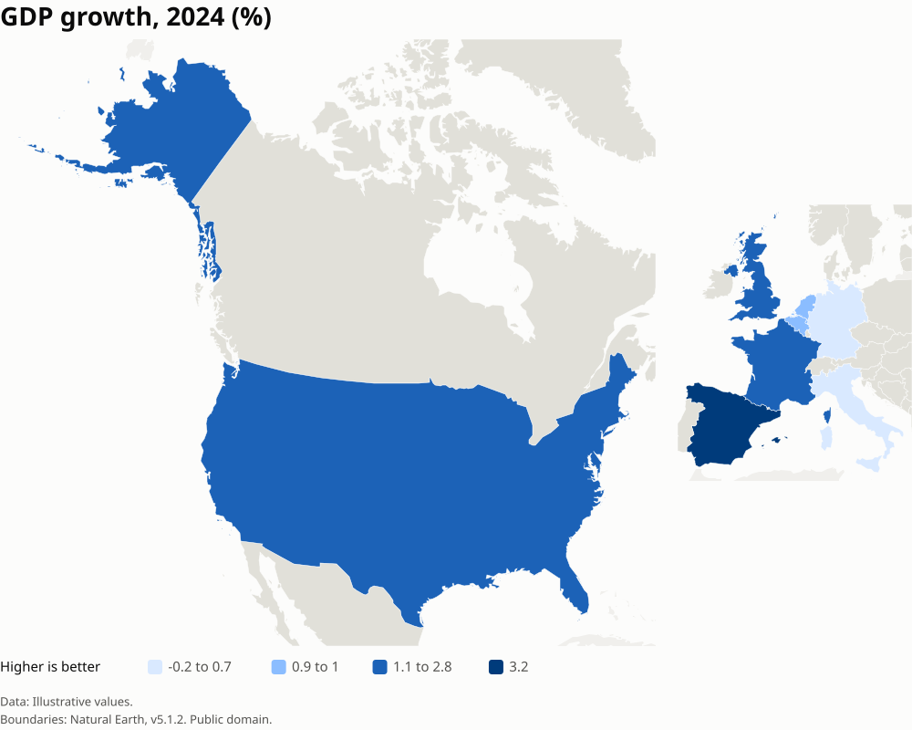
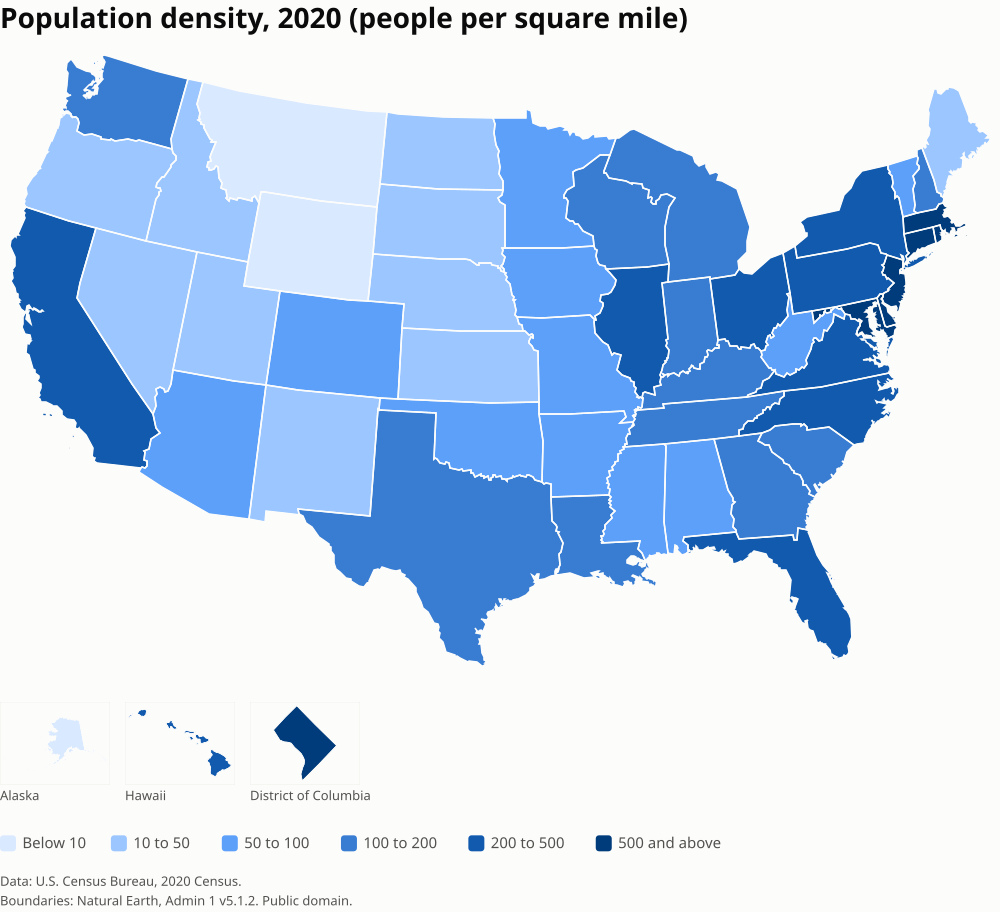
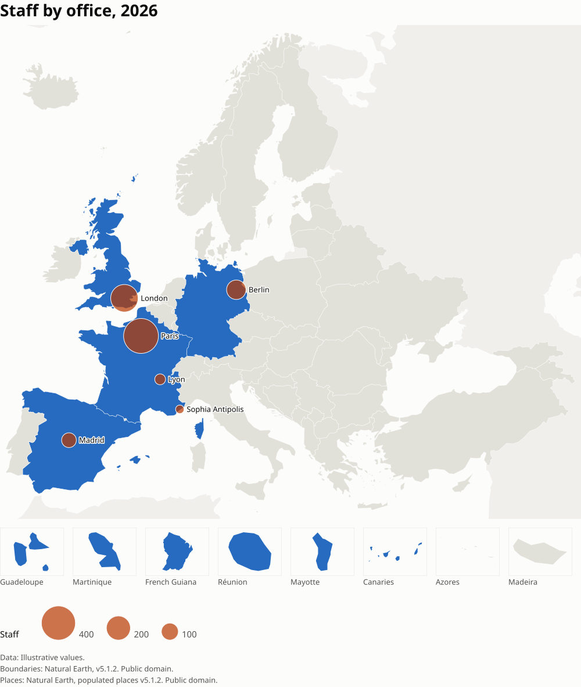

# Maps

## Compare countries far apart at the same scale

List the countries in a layout:

<!-- prettier-ignore -->
```json
{
  "sheet": { "places": ["USA", "GBR", "FRA", "ESP", "BEL", "NLD", "DEU", "ITA"], "insets": false },
  "title": "GDP growth, 2024 (%)",
  "source": "Illustrative values",
  "fill": {
    "kind": "choropleth",
    "values": [
      { "country": "USA", "value": 2.8 },
      { "country": "GBR", "value": 1.1 },
      { "country": "FRA", "value": 1.1 },
      { "country": "ESP", "value": 3.2 },
      { "country": "BEL", "value": 1 },
      { "country": "NLD", "value": 0.9 },
      { "country": "DEU", "value": -0.2 },
      { "country": "ITA", "value": 0.7 }
    ],
    "better": "higher"
  }
}
```



1. Countries more than 2,000 km apart go in separate panels.
2. A kilometre is as long in every panel, so countries compare by size as well as colour. `"scale": "fit"` makes the panels equally tall instead.

## Colour a country's states or regions

Name areas by ISO 3166-2 code with `area` instead of `country`:

```jsonc
{
  "title": "Population density, 2020 (people per square mile)",
  "source": "U.S. Census Bureau, 2020 Census",
  "fill": {
    "kind": "choropleth",
    "values": [
      { "area": "US-AL", "value": 99 },
      { "area": "US-AK", "value": 1.3 },
      { "area": "US-AZ", "value": 63 },
      // … one row per state and DC
    ],
    "scale": { "kind": "breaks", "at": [10, 50, 100, 200, 500] },
  },
}
```



1. The codes pick the map: `US-` codes draw the United States.
2. A fill names countries or areas, not both, and its areas belong to one country.
3. Highlights take `areas` too: `{ "kind": "highlight", "areas": ["FR-IDF", "FR-BRE"] }`.
4. Some areas have no ISO 3166-2 code yet and cannot be named. `scripts/build-maps/uncoded.gen.ts` lists them.

## Mark cities, offices or events

`points` marks sites over the map, with or without a fill. Name a city and its country, or give coordinates from your data:

```json
{
  "title": "Staff by office, 2026",
  "source": "Illustrative values",
  "fill": { "kind": "highlight", "countries": ["FRA", "DEU", "GBR", "ESP"] },
  "points": {
    "kind": "bubble",
    "label": "Staff",
    "sites": [
      { "place": "Paris", "country": "FRA", "value": 420 },
      { "place": "London", "country": "GBR", "value": 260 },
      { "place": "Berlin", "country": "DEU", "value": 130 },
      { "place": "Madrid", "country": "ESP", "value": 75 },
      { "place": "Lyon", "country": "FRA", "value": 40 },
      { "name": "Sophia Antipolis", "lat": 43.62, "lon": 7.05, "value": 25 }
    ]
  }
}
```



1. `"dot"` shows where. `"bubble"` also shows how much: each circle's area is its value, from 0. Put signed values, such as changes, in a choropleth.
2. Cities come from Natural Earth's 7,267 populated places. Names match without accents or case and by their other names, so `"Zurich"` finds Zürich. A name several places share asks for an `area`, and an unknown one asks for coordinates.
3. Take `lat` and `lon` from your data or a geocoder, never from memory.
4. Without `sheet`, the map is the smallest region that holds the fill and every point. Points in the Canaries, Hawaii or Réunion are drawn in their inset.
5. Up to 12 points are labelled where the name fits. Every point has a tooltip and a row in `scene.points.sites`.
